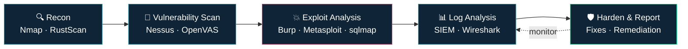

<p align="center">
  
</p>

<p align="center">
  <a href="https://git.io/typing-svg">
    
  </a>
</p>

<p align="center">
  <a href="https://www.linkedin.com/in/arif-k%C3%B6ken-b5b184225/"></a>
  <a href="mailto:arifkoken3@gmail.com"></a>
  
  
</p>

<br>

<p align="center">
  
</p>

---

## 🕵️ `> cat about_me.yml`

<table>
<tr>
<td width="58%" valign="top">

```yaml
name:      Arif Köken
role:      Cyber Security Expert
company:   OGAR Soft (Co-Founder)
also_at:
  - YSF Bilişim  -> Cyber Security Specialist
  - Terzy App    -> Mobile Software Developer
education: B.Sc. Software Engineering
           @ Beykent University
location:  Istanbul, Türkiye 🇹🇷
languages: [ Turkish, English ]
```

</td>
<td width="42%" valign="top">

**⚡ Currently**

- 🛡️ Securing **CRM & web apps** against OWASP Top 10
- 🏢 Building security, CRM & web services at **OGAR Soft**
- 📱 Developing the **Terzy** mobile app
- 📚 Studying for **Cisco CCNA**
- 🤖 Exploring **AI for cyber security**
- 💬 Ask me about **SIEM, log analysis, network security**

</td>
</tr>
</table>

> *"Think like an attacker, defend like an engineer."*

---

<p align="center">
  
</p>

---

## 🧰 `> ls ./arsenal`

<details open>
<summary><b>🛡️ Offensive & Defensive Security</b></summary>
<br>
<p>
  
  
  
  
  
  
  
  
  
  
  
</p>
</details>

<details open>
<summary><b>💻 Languages & Frameworks</b></summary>
<br>
<p></p>
</details>

<details open>
<summary><b>⚙️ Infrastructure & DevOps</b></summary>
<br>
<p></p>
<p>
  
  
  
  
</p>
</details>

---

## 🧠 `> cat ./methodology.md`



---

## 🔐 `> ./projects --featured`

<p align="center">
  <a href="https://github.com/ArifKoken80/mini_siem"></a>
  <a href="https://github.com/ArifKoken80/simple-port-scanner"></a>
</p>

| | Project | What it does | Stack |
|:-:|---|---|---|
| 🛡️ | **[Mini SIEM](https://github.com/ArifKoken80/mini_siem)** | SOC-style log analysis — detects brute force, SQLi & exploit attempts, scores risk per IP, ranks top attackers on a live dashboard | `Python` `Flask` `Chart.js` |
| 🔍 | **[Port Scanner](https://github.com/ArifKoken80/simple-port-scanner)** | Multi-threaded TCP scanner with service detection & banner grabbing | `Python` `socket` |
| 🔒 | **Private repositories** | More comprehensive security, CRM & web projects — available on request | `classified` |

---

## 📡 `> ./stats --live`

<p align="center">
  
</p>

<p align="center">
  
  
</p>

<p align="center">
  
</p>

<p align="center">
  
</p>

---

## 🐍 `> ./snake --eat-contributions`

<p align="center">
  <picture>
    <source media="(prefers-color-scheme: dark)" srcset="https://raw.githubusercontent.com/ArifKoken80/ArifKoken80/output/github-snake-dark.svg" />
    
  </picture>
</p>

<p align="center">
  
</p>
